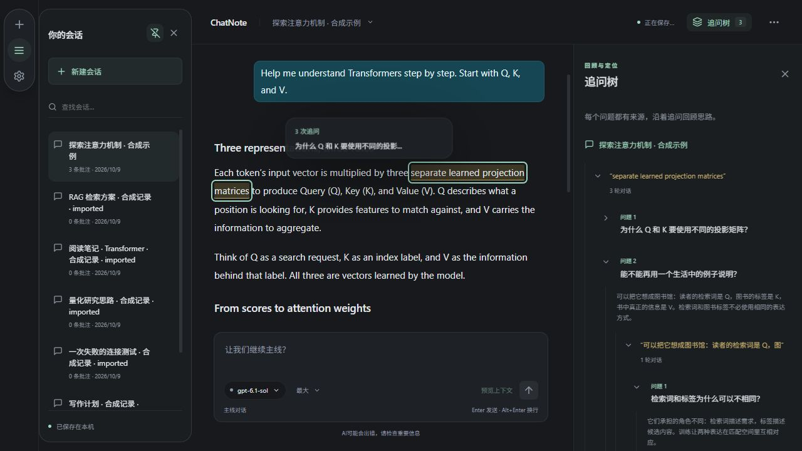
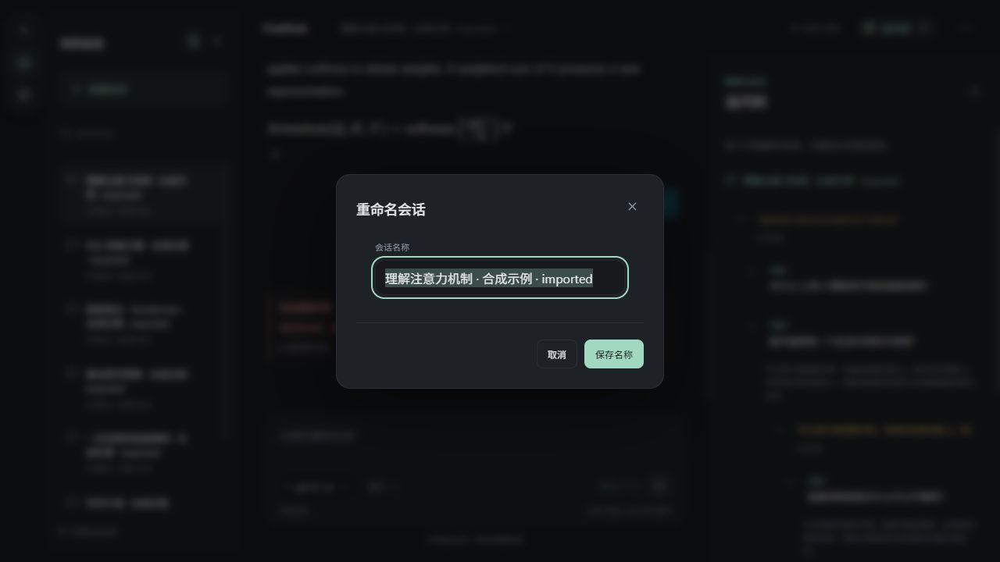

# 输入提示、会话改名与批注摘要 · 开发预览

2026-10-09。正式版仍为 0.5.0，本轮仅更新开发源码，积累后再统一发布 0.6.0。

双击根目录 `启动开发预览.cmd` 打开；已运行窗口通常自动刷新，语言文案若仍旧请刷新窗口。

- 主线输入框下方删除“选中原文，在批注中继续追问。”与重复模型名称，居中显示“AI可能会出错，请检查重要信息”。批注下方也使用同一提醒，鼠标保持普通箭头；输入框内仍正常输入，模型选择按钮仍保留。
- 空主线：“你想探索什么？”；已有主线：“让我们继续主线？”；批注：“继续追问？”。输入提示不会写入草稿或请求。
- 点击左上会话名称打开应用内圆角弹性改名框，聚焦选中名称；Enter 保存，Escape/取消/外部点击退出。仅改名称，保留消息、锚点、草稿和连接。
- 悬停或键盘聚焦批注文字/已批注公式，只显示当前追问轮数和最早首问前 18 个 Unicode 字符；超出加省略号。编辑版本不重复计数，私人笔记不计为追问。多个重叠批注汇总该区域的当前轮数。
- 批注提示与改名共用菜单弹性动画，遵循系统减少动态效果。提示自动避开窗口边缘，滚动更新位置，Escape 可关闭；提示文本不混入原文选区。

自动检查：84 项前端测试与 TypeScript/Vite 编译通过；最终提示定位/聚焦调整后补跑 RichText 4 项检查并再次编译通过。新增检查覆盖状态文案、取消/空名/保存、保留内容草稿、追问次数与 Unicode 截断、来源选区和打开批注。三语资源键和参数同步。

助手实际检查：独立浏览器端口 1424，沿用此前合成示例；改名保存/重载、摘要为 3 次追问、16px 圆角及菜单弹性动画、普通光标、主线/批注/新对话提示、默认 1280px 和 390px 窄窗无横向溢出。没有修改原生用户数据或凭据，也没有发送推理。原生手感与系统减少动态效果仍待用户验收；动画支持不等同于已在该系统选项下实测。

样式可在 `src/navigation.css` 的 `.ai-notice`、`.rename-modal`、`.annotation-hint` 调整；输入文案在 `src/locales`，摘要长度在 `src/AnnotationHint.tsx`。原手动气泡内边距和圆角保持。

