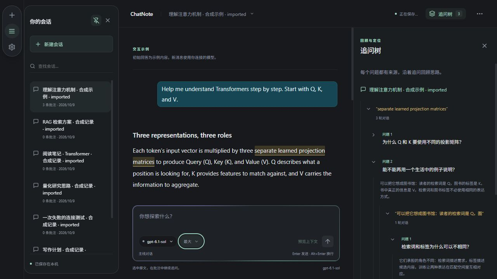
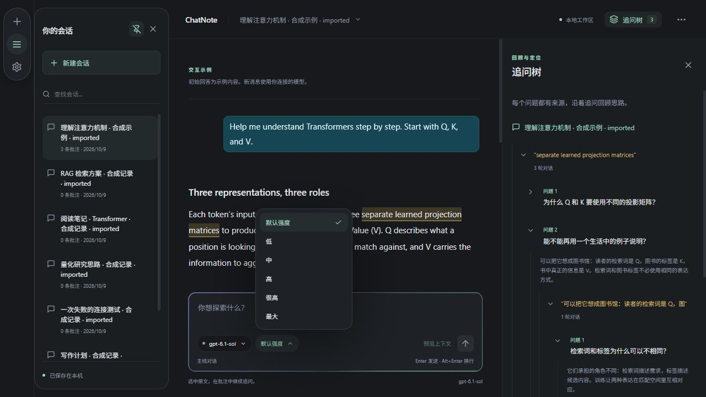

# 历史管理、追问树与菜单 · 未发布开发预览

日期：2026-10-09。用户明确要求先积累开发改动，再统一发布 **0.6.0**；本轮版本号仍为 0.5.0，不生成正式 exe、安装包、标签或 Release。

## 使用

- 打开左侧历史栏，鼠标移到某个会话行上会出现垃圾桶；可以直接删除旧会话，不必先切换进去。键盘聚焦和触屏同样提供入口。
- 鼠标停留在回答区域，回答下方出现删除图标；空白失败回答、网络错误记录和停止的部分回答也可删除。对应问题和同一线程的其他消息保留。
- 删除先显示确认框；如果回答关联了批注或私人笔记，显示会一并删除的数量及下级范围。确认前可以取消；生成期间禁用删除。
- 历史栏右上角的图钉用于固定/取消固定。固定后，新建和切换会话不自动收起；再次启动会恢复偏好。
- 1060 像素及以上窗口使用独立左栏：历史 244 像素，中间为当前会话，右侧为批注/追问树；右侧拖动范围考虑左栏空间，保留中间至少 420 像素。更窄窗口使用原浮层模式，固定偏好保留。
- 右上角打开追问树。同一批注中的每轮问题都能展开回答；根据某条回答继续产生的追问显示在该回答下方，可逐层收起。箭头控制展开，问题/回答文字用于打开并定位原对话。收起状态保存到会话。
- 旧回答版本产生的下级批注仍列在“历史回答版本中的追问”，原来源和跳转保留。
- 右侧面板从右向左滑入（约 420 ms），关闭时滑出。输入区的模型、强度和连接菜单采用圆角；强度/连接替换系统原生菜单，约 380 ms 弹性动效，支持上下键、Home/End、Enter、Escape、Tab 和点击外部关闭。

开发窗口通常自动刷新；若刚修改文案后出现混合语言或旧界面，刷新开发窗口。完整启动方式见 [开发预览说明](DEVELOPMENT_PREVIEW.md)。

## 数据行为

- 删除会话不会改动其他会话、草稿、连接 metadata 或凭据。删除最后一个会话后建立一个空会话，不加载示例。
- 删除回答从规范消息集合、当前显示路径和历史版本路径同步移除同一条消息；不让它在切换版本后再次出现。
- 只删除直接引用该回答的批注/笔记及其下级链条，其他批注保留。清理被删内容的选区、草稿来源、阅读位置和收起状态，剩余工作区通过原来源校验。
- 本轮没有回收站。既有备份、其他回答已保存的请求上下文与独立结论不改写；删除不是对所有历史副本的擦除。
- 只新增可选 `historyPinned` 偏好；数据格式版本、原消息文本/offset/revision、账号注册和凭据路径不变。手动调整过的气泡圆角/内边距不改动。

## 验证与边界

- 自动检查：81 项前端测试、TypeScript/Vite 编译和差异格式通过；覆盖删除/取消、旧会话/最后会话、空白失败记录、关联多级批注、历史回答版本、草稿保留、固定栏新建/切换/重启、窄屏偏好保留、逐轮收起和历史来源、三语匹配，以及菜单键盘/焦点/禁用行为。
- 助手浏览器检查：独立端口 1424、合成会话；验证历史/回答删除确认及取消、三级追问收起展开、固定后切换仍显示、重载恢复、菜单圆角/弹性动画/键盘选择，以及深浅主题。
- 布局实测：1280 像素窗口为 62/244/604/370 像素（导航/历史/主线/右栏）；1060 窗口主线 420、右栏 334；390 窗口回到浮层，强度菜单留在视口内，文档无水平溢出。
- 没有删除用户原生真实记录、重置数据或访问凭据，没有发送真实推理。本轮不修改原生网络代码，不将既有 Rust 测试称为本轮新检查。
- 用户尚未验收真实历史清理、桌面三栏布局和动效手感。用户本轮反馈网络暂时正常、希望继续观察；不据此宣称长期网络问题已解决，也不自动发起推理监测。

视觉示例：

主要外观参数在 `src/navigation.css`；现有气泡参数继续位于 `src/message-bubbles.css`。

本轮完成开发实现 I33/I34/I35/I36，并完善 I17 动画；用户验收和 0.6.0 正式交付仍待进行。I15 直接回答编辑/重生成、I21 自动更新、I28 附件等待办保持。
