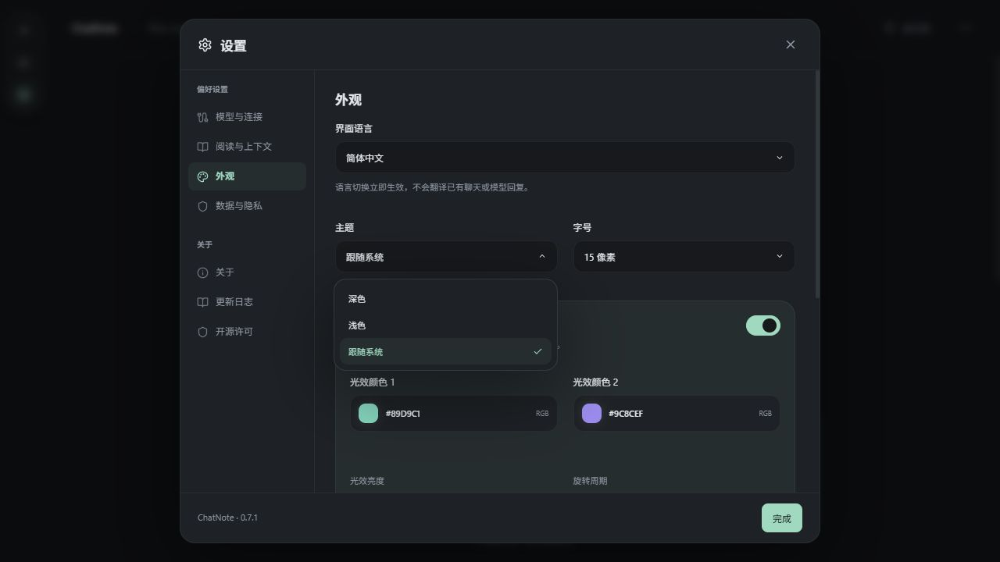

# 开发预览 · 圆角图标与跟随系统主题

日期：2026-10-10。基于正式版 0.7.1 的未发布预览；版本号不增加，不打新标签，不创建 Release 或安装包，不替换任何已交付文件。

## 使用

关闭当前 ChatNote/开发预览窗口后，双击 [启动开发预览.cmd](../启动开发预览.cmd)。界面热刷新即可出现新选项；窗口/任务栏原生图标需要退出并重启预览后生效，无需退出账号。当前源代码已准备好，启动入口会重新编译被旧进程占用的调试文件。

设置 → 外观 → 主题提供“深色 / 浅色 / 跟随系统”，选择后点击完成。跟随系统监听操作系统的应用配色偏好变化，自动应用深浅色；明确选择深色/浅色后停止跟随。已有工作区的手动主题保持原值，不擅自改变默认设置。

可直接启动的临时调试预览位于 `.desktop-test/previews/ChatNote_preview_2026-10-10_round-theme.exe`，同样需先关闭已有窗口；它嵌入界面资源，不需要另起开发服务，版本显示仍为 0.7.1，用文件名区分。它是本地可复现预览，不是正式发布文件。

## 最终改动

- 原母图为不透明 RGB，画了内侧圆角却保留整张图片的白色直角。保存原选定图为 `docs/branding/forest-approved-square.png`，哈希仍为 `8f840c204faf4cd9228e968d69b2f17deb5fecfb544e78232a03bc66a3c12ca0`。
- `app-icon.svg` 内嵌原图，以约 20% 半径的 SVG 圆角裁切生成真正透明的四角；保留五棵树、曲线和颜色，不另行生成或重绘图案。用 Tauri 图标工具生成 Windows PNG/ICO、ICNS 及平台尺寸，应用/网页 PNG 同步为 512px RGBA。其他平台仍只准备资源，未验收。
- 新增可选布尔偏好 `followSystemTheme`。原 `theme` 字段始终保留合法的 `dark` 或 `light`，为 0.7.1 的读写提供手动主题回退，不向旧字段写入 `system`；旧版不会动态跟随系统，只会读取保存的回退配色。会话、锚点、草稿、模型/连接及本地注册路径不变。
- 跟随系统时仅修改实际显示的配色，不把 OS 事件写成会话/偏好变更；切换手动主题或卸载时清理监听。三语新增文案齐全、占位符一致，保留原弹性下拉菜单。

## 验证

- 自动检查：99 项前端回归通过；新增检查覆盖 OS 深浅色事件、切换手动主题/卸载后清理监听、偏好不被事件修改、备份合法性与原记录保留。TypeScript/Vite 构建通过。
- 图标：512px RGBA 母图四角透明；ICO 的 16/24/32/48/64/256 六种帧四角透明。保留原选定图哈希，128px 人工查看图案及圆角边界。
- 原生构建：已有开发窗口占用标准调试 EXE，初次构建链接失败；没有关闭用户窗口。改用 `.cache/preview-rounded-system-target` 独立目录完成 debug/no-bundle 构建，耗时约 2 分 15 秒；不生成安装包。临时程序内嵌六种 ICO 帧均与本次生成资源逐字节匹配；复制哈希一致；22 个历史/当前正式交付文件的原 SHA-256 全部保持一致。
- 助手实际浏览器检查：独立端口 1427、合成空工作区；主题三选项、跟随系统保存/重载、简体文案、手动浅色后回到系统配色通过。当前浏览器系统偏好为深色，跟随时实际配色为深色，手动浅色显示浅色；界面错误日志为空。
- 系统变化的自动切换使用合成 OS 偏好事件验证，未更改用户系统设置。实际用户窗口的重启图标、Windows 图标缓存刷新、日常手感、真实模型调用仍待用户验收。未访问或重置真实工作区，不发推理请求。

## 记录

I45 圆角图标透明边界、I46 跟随系统主题：预览已实现并本地检查，未正式交付。正式版仍为 0.7.1，原安装包、程序和 Release 保留。

临时预览程序 SHA-256：c46a3b87ae7b2df934ad195ea9ab907fdb32cb45a6a8ddc842ea0a0c48520cf3。文件版本仍为 0.7.1，不是新正式版。
