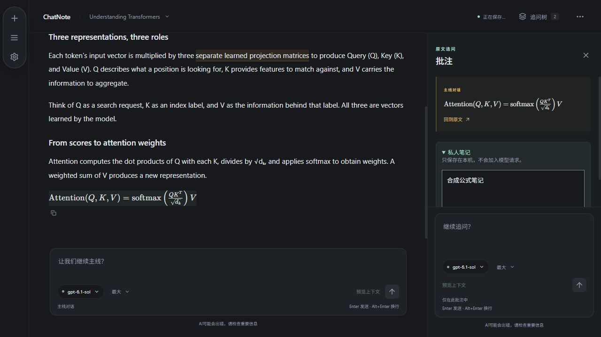
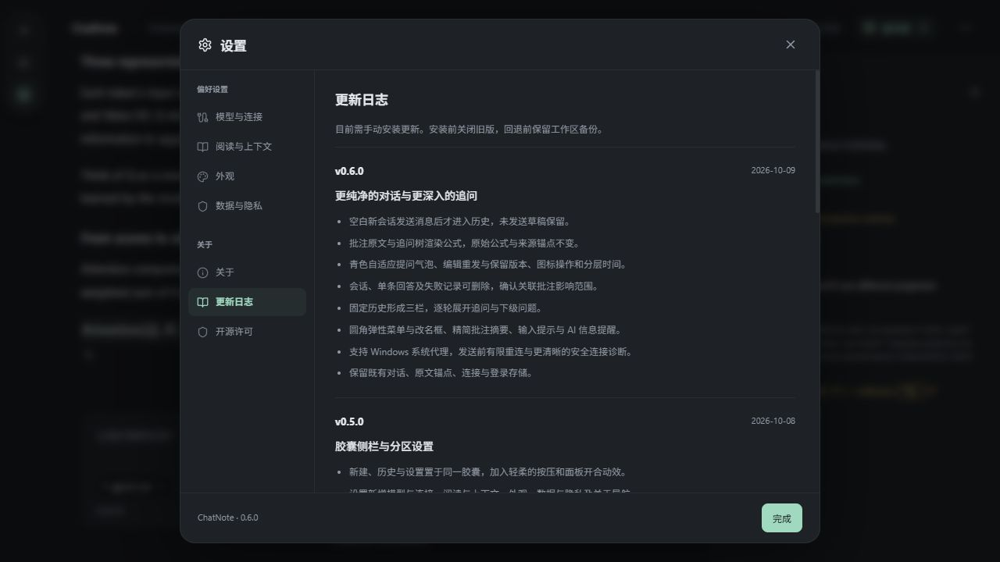

# ChatNote v0.6.0 · 对话与追问体验升级

日期：2026-10-09。Windows x64 正式交付版本；软件内关于/更新日志、前端和原生版本统一为 0.6.0。

## 本版行为

- 空白新会话不进入历史列表；发送第一条消息后出现，失败/中断的已发送会话仍保留。反复新建时复用当前空输入页，保留未发送草稿；旧空记录不展示，不批量删除已有数据库记录。
- 批注原文、追问树来源完整解析 Markdown/LaTeX（\(\)、\[\]、$ 与 $$），长树来源只在视觉上裁切，避免截断公式语法。原文、上下文、代码与来源偏移不变；不完整选区保留可读文字。
- 累积预览改进统一交付：青色自适应提问气泡；问题复制、编辑重发及版本保留；回答去标题/完成统计与图标复制/上下文；悬停操作和分层时间。
- 历史、回答及失败记录删除与关联批注/笔记范围确认；历史固定、三栏排布与逐轮递归追问树；右侧滑入、圆角弹性菜单、改名弹窗、轮数/首问摘要与输入状态提示。
- Windows 系统代理支持、连接发送前有限重连和固定网络诊断；服务器已接收请求或流式断连不自动重发。
- 软件内更新日志完整记录本版，英语/简体/繁体同步；第三方许可按锁文件更新为 657 项（39 项包未附顶层正文，界面明确显示）。

## 数据与升级

应用标识仍为 `app.chatnote.desktop`，SQLite 格式、凭据库服务与 ChatGPT 注册路径不变。不读取或写入实际账号凭据，不重置工作区，不替换聊天为示例。问题版本功能保留完整消息和历史路径；旧版缺少版本选择界面，回退前建议导出工作区备份。

默认开发预览和正式版使用同一工作区。关闭旧版及开发窗口/启动服务，再启动新程序或安装；无需先退出账号。

## 验证

- 自动检查：89 项前端检查、TypeScript/Vite 构建和完整 Windows NSIS 打包通过（原生优化构建约 5 分 48 秒）；21 项常规原生检查通过、5 项显式忽略（4 项凭据写入，1 项公共联网诊断）。Rust 格式检查通过。测试使用合成数据，未发推理。
- 助手实际浏览器检查（独立端口 1424/合成记录）：空历史排除、新页复用/草稿保留、公式批注原文与树渲染无错误、软件内 0.6.0 中文完整更新日志，以及 390px 公式树无横向溢出；此前预览批次的气泡、版本/选区、删除确认、三栏、折叠、菜单、改名、摘要与窄窗口检查已完成，分别见 PREVIEW 系列记录。
- 用户反馈：此前 ChatGPT 对话可用、v0.3.1 升级保留登录；10/9 网络暂时正常。它们不等同于本版安装、真实调用或长期稳定性验收。
- 本版真实安装升级、日常手感、真实模型调用和长期账号续期仍待用户验证；其他平台未交付。系统减少动态效果 CSS 已实现，未修改用户 OS 偏好作实测。

## 发布与文件

Windows 程序和 NSIS 安装包已构建并复制校验；全部历史文件和 v0.4.0 归档校验通过。源码/私有 Release 同步状态将在发布后记录。

| 文件 | SHA-256 |
| --- | --- |
| ChatNote_0.6.0.exe | `1df791af4ee583fcb63bb5452eb113196f764ab44d16e64e3de43ed027ffc5da` |
| ChatNote_0.6.0_x64-setup.exe | `f184abbf9f4dfddad9ce697845af8f6f1c6ba1a6f75fa9f9cba07491b579271d` |

常用目录保留 0.6.0 与 0.5.0；0.4.0 归档到 `releases/archive/v0.4.0`，更早版本继续保留。归档与全部历史文件需核对 SHA-256。

I32–I39 本版完成，I04/I17 继续完善，I15 的问题编辑与版本已完成；直接回答编辑/重生成、I21 签名/自动更新、I28 附件、长期连接验收继续待办。

