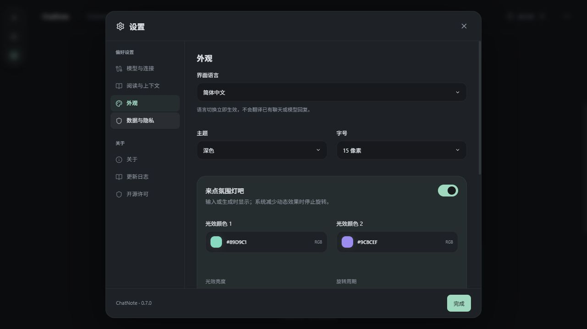

# ChatNote v0.7.0 · 细节交互与统一批注高光

日期：2026-10-09。Windows x64 正式交付版本；关于、三语更新日志、前端与原生版本统一为 0.7.0。

## 最终行为

- 删除回答时删除对应问题及该轮重试回答，不再留下孤立问题气泡；确认框说明关联批注/笔记影响范围。清理全部保存路径、编辑草稿与阅读位置；其他轮次和独立的问题版本保留，生成中不能删除。
- 移除右上角“本地工作区”和追问树“回顾与定位”及说明句；工具栏、树标题与空树使用简笔树图标。具体追问页提供“返回概览”，保留子批注返回父级入口。
- 回到原文依据保存的消息版本、源偏移和渲染映射定位到所选文字/公式的实际行；先恢复正确历史路径，定位后临时标示选区，支持多段格式、转义字符和公式原子区域。浏览器支持时使用 CSS Highlight，否则在对应渲染片段显示定位框；不修改原文或系统选择。
- 上下文预览允许空草稿查看已有上下文，也可预览主线、追问或新批注的未发送问题；预览不新增消息、不清空草稿、不调用模型。发送超预算时仍保留原有确认流程。
- 更多操作支持点击外部、按钮再次点击及 Escape 关闭。外观的语言/主题/字号、上下文预算、连接预设、可用模型与输入区模型/连接/思考强度统一使用圆角弹性菜单，退出保留短暂动效；浮层独立于滚动容器，支持键盘、窗口边界与减少动态效果。修复聚焦/自动滚动误关闭菜单的问题。
- “私人笔记”栏目改为“笔记”；圆角卡片、输入框、聚焦描边及展开动效。笔记依然不发送给模型。
- “来点氛围灯吧”标题右侧提供胶囊开关；双色预设、RGB 三通道拉条、亮度/周期和恢复默认颜色。恢复颜色只恢复两种颜色，保留开关、亮度和周期。
- 外观新增批注高光：黄/绿/青/粉/紫/橙六种荧光笔色，0–100% 线性不透明度，不开放自定义 RGB。已有和新增文字/公式批注共用偏好，不改变锚点或来源。

## 数据与升级

保留应用标识 `app.chatnote.desktop`、SQLite 格式、系统凭据库服务和 ChatGPT 注册路径。新增高光仅为可选设置元数据，旧工作区无须重置；测试覆盖偏好备份、非法输入拒绝、原文/锚点/连接保留。没有读取或写入实际账号密钥，没有将用户数据替换为示例。

先关闭旧版及开发预览窗口/启动服务，再启动新版程序或安装，无需退出账号。回退前导出完整工作区备份。

## 验证与边界

- 自动检查：96 项前端回归通过（16 个文件）；TypeScript/Vite、Rust 格式检查通过；21 项常规原生检查通过，5 项凭据写入/公共联网诊断显式忽略。合成测试覆盖成对删除/关联递归清理/保存版本、预览无推理、外部关闭/滚动与键盘菜单、树返回、设置保存、源偏移/转义/公式定位、三语键与占位符匹配、高光偏好备份与旧设置兼容。
- 助手实际浏览器检查：独立端口 1425 合成示例；更多菜单弹性与外部关闭、树概览往返、笔记展开编辑、上下文预览、中文外观菜单、RGB 预设和恢复默认颜色、统一文字/公式高光、来源定位及 390px 外观菜单边界。粉色文字与公式均为 `rgba(244, 151, 191, 0.3)`。页面宽度 390px，无页面横向溢出；桌面与窄窗截图保存于 `docs/screenshots`。
- 用户反馈：本轮指出 v0.6.0 删除孤立问题、预览和菜单等体验问题；之前套餐对话和 v0.3.1 升级保留登录曾由用户确认。这些不等同于本版安装升级、真实调用或手感验收。
- 本版安装升级、真实模型调用、长期登录续期与用户动效手感待用户验收；其他平台未交付；仍未签名、手动更新。减少动态效果规则保留，未更改用户系统设置作实测。

## 发布与文件

最终 Windows NSIS 构建通过（原生优化构建约 3 分 12 秒），直接启动程序与安装包的文件版本均为 0.7.0，复制前后 SHA-256 一致。20 个当前/历史交付文件校验全部通过；常用目录保留 0.7.0 与 0.6.0，0.5.0 归档到 releases/archive/v0.5.0，移动前后校验一致。私有 Release 与云端检查结果完成后补充。

完成 I40–I43；I33/I34/I36 继续完善，I04/I17 本版动效与 RGB 控件完善；I15 直接回答编辑/重生成、I21 签名/自动更新、I28 附件、长期连接验收继续待办。

| 文件 | SHA-256 |
| --- | --- |
| ChatNote_0.7.0.exe | 2b77fbfdeae175f533825b871c78f277e4682fdd28f959e97956802c8174852d |
| ChatNote_0.7.0_x64-setup.exe | ad794a9e6d8e79aede0b7a0ff5600a12ce08d211e7003dcd4a3f65dc4dabd33c |
