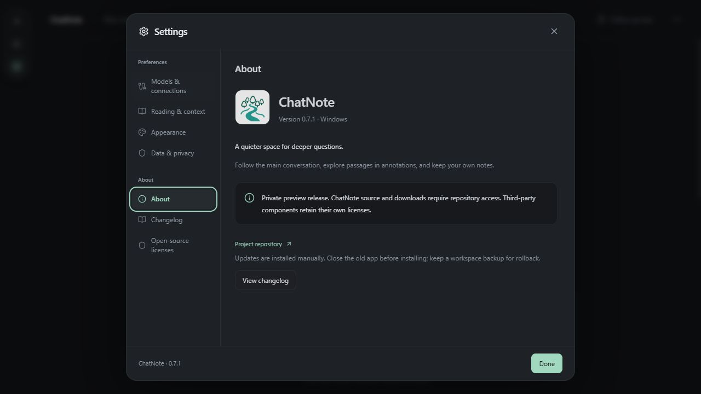

# ChatNote v0.7.1 · 森林与探索图标

日期：2026-10-09。Windows x64 图标升级，软件、原生与软件内日志版本统一为 0.7.1。

## 本版变化

- 作者选定五棵错落轮廓树与蜿蜒探索主线的图标；母图与批准预览 SHA-256 完全一致，保留五树数量、排布、颜色和曲线，未另行重画。
- 应用/窗口/任务栏与 Windows 安装包使用新 ICO；启动、空会话欢迎、关于页面及浏览器标签图标同步。图标尺寸由 Tauri 标准工具生成。
- Windows PNG/ICO、macOS ICNS、iOS/Android 图标资源同步；其他平台只准备资源，未交付或验收。旧标志 SVG 来源保留在 docs/branding，旧程序及安装包按发布规则保留。
- 英语/简体/繁体软件内更新日志同步；本版只调整品牌图标、版本和相应记录，不修改网络、模型请求、工作区/锚点、原生凭据或注册路径。

## 数据与升级

应用标识仍为 `app.chatnote.desktop`，SQLite 版本、原生凭据库服务及 ChatGPT 注册路径保持不变。不重置工作区，不读取或改写真实账号凭据，不替换用户会话为示例。关闭旧版及开发预览窗口/服务后升级，无需退出账号。

## 验证

- 自动检查：96 项前端回归、TypeScript/Vite 构建、Rust 格式检查、21 项常规原生检查通过；5 项凭据写入/公共联网诊断显式忽略，无真实推理。
- 图标检查：批准原图 1254×1254、母图/浏览器副本哈希一致，ICO 包含 16/24/32/48/64/256 六种帧；128px 资源人工查看五树和主线可辨认。最终程序与安装包的 PE 图标资源逐帧与生成 ICO 字节匹配，均包含全部六种尺寸；安装/卸载器显式引用新 ICO。最终 Windows NSIS 构建通过（原生优化构建约 3 分 33 秒）。
- 助手实际浏览器检查：独立端口 1426/空合成浏览器存储，欢迎页图标 64px 正常加载；关于页显示新图标与 0.7.1，图像来源均为批准原图。检查不访问实际桌面工作区或账号。
- 用户验证：已明确认可候选 H 的五树错落设计并授权应用到软件；尚未验收本版 Windows 安装升级、任务栏/快捷方式缓存刷新或实际账号调用。设计认可与应用升级验收分别记录。
- Windows 图标缓存可能使既有快捷方式短暂显示旧图标；应用资源与系统显示分别验证。未更改系统缓存或用户快捷方式。签名/自动更新及其他平台仍待办。

## 交付与记录

程序与安装包文件版本均为 0.7.1，复制前后校验一致；22 个历史/当前文件 SHA-256 全部通过。常用目录及 0.6.0 归档已按下述规则安排，移动前后校验一致。[Windows 云端检查 37951835163](https://github.com/MKCorleonE/ChatNote/actions/runs/37951835163) 全部通过，检查提交 e5afc6bb5dcb51219bb325644452d465847b1596；[PR #7](https://github.com/MKCorleonE/ChatNote/pull/7) 已合入 main，合并提交 638fec154dc29dace3bf47b204616d75e2f8ee24。随后只补全发布校验记录，应用源码与构建文件对应。常用目录保留 0.7.1 和 0.7.0；0.6.0 移入归档前后核对 SHA-256，历史交付文件不替换。

完成 I44（森林与探索品牌图标）；I21 签名/自动更新、I28 附件、真实升级/长期连接验收继续待办。图标来源与重建入口见 [品牌资源说明](branding/README.md)。

| 文件 | SHA-256 |
| --- | --- |
| ChatNote_0.7.1.exe | 4a882ad1ab89ba7ad89cf9f2e6fe852946d3d05ce2ceaa8713332cc0bb96cd92 |
| ChatNote_0.7.1_x64-setup.exe | c184b8882156515e741cf76067337dec920992654fd5293c46186bf66436913e |

[私有 v0.7.1 Release](https://github.com/MKCorleonE/ChatNote/releases/tag/v0.7.1) 的程序、安装包和 SHA256SUMS.txt 三项附件已逐个核对远程上传状态、大小和 SHA-256；正式版本使用非 prerelease 标记。0.6.0 私有历史附件与本地归档哈希一致，历史 Release 未替换。
